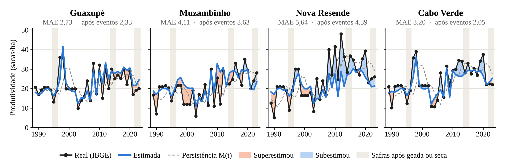
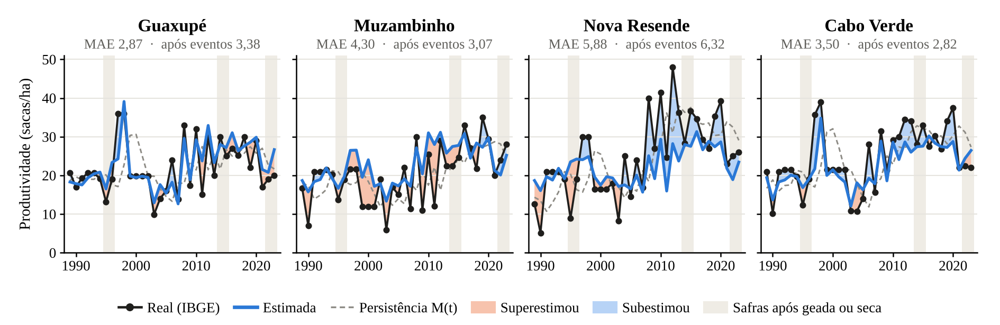
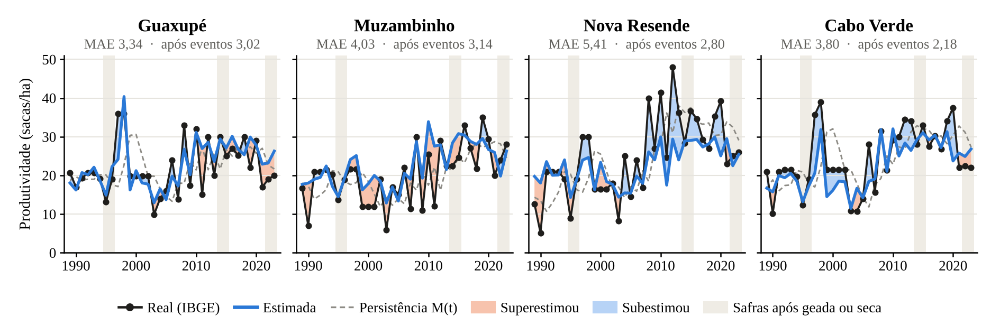
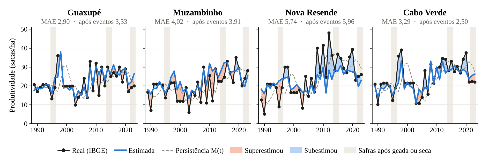
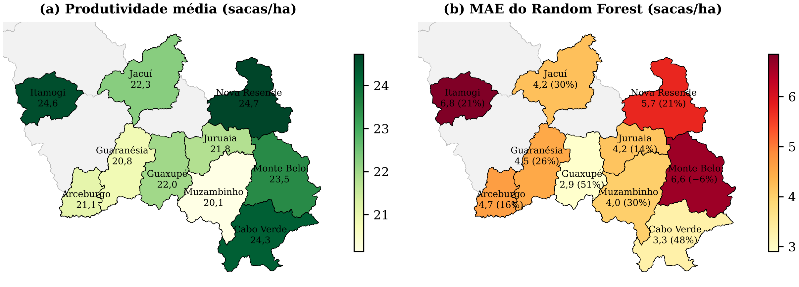
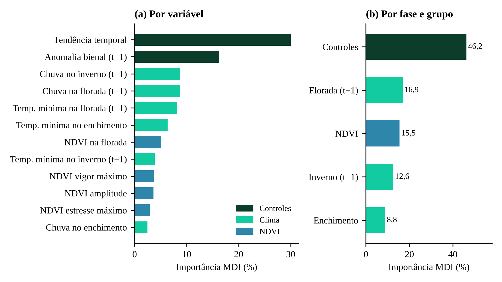
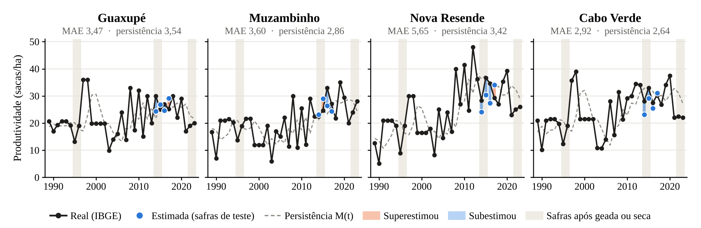
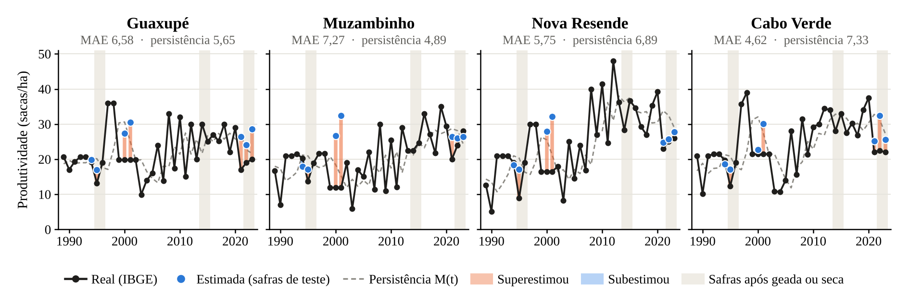

# Contribuição do clima e do NDVI para estimar e antecipar a produtividade do café arábica com Random Forest

Trabalho de Conclusão de Curso em **Engenharia Agronômica**, Instituto Federal do Sul de Minas Gerais (IFSULDEMINAS), Campus Muzambinho.

**Autor:** Luiz Felipe Viana Dias da Silva
**Orientador:** Prof. Dr. Allan Arantes Pereira
**Defesa:** 25 de novembro de 2026

Este repositório reúne os dados, os códigos e os resultados do TCC, na ordem em que o trabalho foi feito: coleta dos dados, pré-processamento, montagem da base, modelagem e avaliação. Todos os números das tabelas do texto são reproduzidos pelos scripts daqui.

---

## Sumário

1. [Resumo](#1-resumo)
2. [Área de estudo](#2-área-de-estudo)
3. [Perguntas e hipótese](#3-perguntas-e-hipótese)
4. [Dados](#4-dados)
5. [Fluxo do trabalho e organização do repositório](#5-fluxo-do-trabalho-e-organização-do-repositório)
6. [Como rodar](#6-como-rodar)
7. [Metodologia, etapa por etapa](#7-metodologia-etapa-por-etapa)
8. [Resultados](#8-resultados)
9. [Experimentos e versões anteriores](#9-experimentos-e-versões-anteriores)
10. [Limitações](#10-limitações)
11. [Reprodutibilidade](#11-reprodutibilidade)
12. [Referências principais](#12-referências-principais)

---

## 1. Resumo

A produtividade do café arábica depende do clima e da **bienalidade**, a alternância entre safras de alta e de baixa carga. Separar o que é dano climático do que é ciclo bienal ou ganho tecnológico é difícil, porque as séries oficiais misturam tudo.

Este trabalho montou uma base municipal de **1989 a 2023** (10 municípios × 35 safras = **350 observações**) com o rendimento do IBGE, o clima do ERA5-Land por fase fenológica e o NDVI das lavouras de café (Landsat 5, 7 e 8, só nos pixels de café do MapBiomas). Com ela, **seis cenários de Random Forest** foram comparados à persistência histórica (a média das três safras anteriores):

| Cenário | Variáveis | Validação |
|---|---|---|
| 1 Base | tendência temporal + anomalia bienal | validação cruzada aninhada |
| 2 Base + clima | base + chuva e mínima no inverno, florada e enchimento | validação cruzada aninhada |
| 3 Base + NDVI | base + vigor, estresse, NDVI na florada e amplitude | validação cruzada aninhada |
| 4 Completo | base + clima + NDVI (12 variáveis) | validação cruzada aninhada e safra inteira fora |
| 5 Previsor de seca | base + déficit hídrico e máxima da expansão dos grãos | janela expansiva, 2014-2017 |
| 6 Previsor de geada | base + mínima, dias abaixo de 3 °C e chuva do inverno | janela expansiva, safras das geadas de 1994, 2000 e 2021 e seguintes |

Principais resultados:

* Os cenários 1 a 4 completaram a série com erro médio absoluto (MAE) de **4,54 a 4,76 sacas/ha**, contra **6,26** da persistência (−24% a −27%), com diferença significativa também no teste por safra (p de 0,003 a 0,029). Sem as safras de 1991 a 2002, em que o IBGE repete valores, de 4,18 a 4,34 contra 6,20.
* **Acrescentar clima, NDVI ou os dois ao Cenário 1 não reduziu o erro** (p por safra de 0,29 a 0,35; 1 após o ajuste de Holm): a hipótese foi rejeitada. O ganho sobre a persistência vem da tendência temporal e da anomalia bienal.
* Com a **safra inteira fora do treino**, o Cenário 4 errou **6,05 sacas/ha**, sem diferença da persistência (p = 0,73 por safra): o ganho depende dos outros municípios da mesma safra no treino.
* Pelo MDI, a **florada (t−1)** concentra 44% da importância do clima, o **inverno (t−1)** 33% e o **enchimento** 23%. Nas safras de evento, os quatro cenários estimam praticamente o mesmo valor: em 2022, após a geada de 2021, de 21,2 a 21,6 sacas/ha, para uma produtividade real de 20,5 (persistência: 27,3).
* Os previsores de seca e de geada **não superaram** a persistência (seca: 4,16 contra 4,21 sacas/ha; geada: 6,90 contra 5,91), pelo pequeno número de eventos na série.

---

## 2. Área de estudo

Dez dos 14 municípios da microrregião de São Sebastião do Paraíso, no Sul de Minas Gerais: **Arceburgo, Cabo Verde, Guaranésia, Guaxupé, Itamogi, Jacuí, Juruaia, Monte Belo, Muzambinho e Nova Resende**, os que têm a série de produtividade de café completa na PAM de 1988 a 2023. Somaram 59,7 mil ha de café colhidos em 2023 (IBGE). Clima Cwa e Cwb, com chuvas de outubro a março e inverno seco, quando ocorrem as geadas.

A **unidade de observação** é o município em cada safra, porque a produção vem do levantamento municipal do IBGE.


---

## 3. Perguntas e hipótese

**Pergunta:** dados públicos de clima e de satélite, combinados com o Random Forest, melhoram a estimativa da produtividade além do que a tendência e a bienalidade já explicam, e permitem antecipar a safra em anos de seca e de geada?

Os cenários 1 a 4 respondem à primeira parte (o Cenário 1 é a base, e os outros acrescentam clima, NDVI ou os dois); os cenários 5 e 6, à segunda.

**Hipótese:** o clima e o NDVI reduzem o erro de estimativa do Random Forest além do obtido só com a tendência e a bienalidade (cenários 2, 3 e 4 erram menos que o Cenário 1).

**Objetivos específicos:** (i) construir a base municipal 1989-2023; (ii) comparar os cenários 1 a 4 com a persistência histórica e entre si; (iii) identificar, pelo MDI, em que fase do ciclo o clima mais pesa no modelo; (iv) testar a previsão antes da colheita nos eventos de seca e de geada (cenários 5 e 6).

---

## 4. Dados

Todas as bases são públicas e cobrem 1988 a 2023. A safra de 1988 serve só para as defasagens.

| Dado | Fonte | Acesso | Arquivo em `dados/brutos/` |
|---|---|---|---|
| Produção (área, produção, rendimento) | IBGE, PAM, Tabela 1613 | API do SIDRA | `producao_ibge_pam_1988_2023.csv` |
| Clima diário (mínima e chuva) | ERA5-Land, ~11 km | Google Earth Engine | `clima_era5land_janelas_1988_2023.csv` |
| Enchimento (dez t−1 a abr t) | ERA5-Land, ~11 km | Google Earth Engine | `clima_enchimento_dez_abr_1988_2023.csv` |
| Imagens (NDVI) | Landsat 5, 7 e 8, Coleção 2, 30 m | Google Earth Engine | `ndvi_landsat_por_sensor_1989_2023.csv` |
| Área de café (máscara) | MapBiomas, Coleção 9, classe 46 | Google Earth Engine | usada nas extrações |
| Balanço hídrico | ERA5 e ERA5-Land via Open-Meteo, na sede | API Open-Meteo | `balanco_hidrico_openmeteo_1988_2023.csv` |

O dicionário de cada coluna está em [`dados/README.md`](dados/README.md).

> **Uma observação sobre o clima.** Todo o clima vem da família ERA5. O que muda é o acesso: para as fases fenológicas, a média sobre a área de café, no Earth Engine; para o balanço hídrico do previsor de seca, um ponto na sede do município, pelo Open-Meteo.

---

## 5. Fluxo do trabalho e organização do repositório


```
tcc-cafe-sensoriamento-remoto/
├── config.py                      caminhos, variáveis, hiperparâmetros e funções comuns
├── executar_tudo.py               roda as etapas 2 a 5 em ordem
├── requirements.txt
│
├── etapa1_coleta/                 ETAPA 1: de onde vêm os dados (precisa de internet)
│   ├── 1a_producao_ibge_sidra.py
│   ├── 1b_clima_era5land_gee.py
│   ├── 1b2_enchimento_dez_abr_gee.py   janela de enchimento corrigida
│   ├── 1c_ndvi_landsat_gee.py
│   └── 1d_balanco_hidrico_openmeteo.py
│
├── etapa2_preprocessamento/       ETAPA 2: auditoria e calibração
│   ├── 2a_auditoria_e_matriz.py
│   └── 2b_calibracao_ndvi.py
│
├── etapa3_base/                   ETAPA 3: base de modelagem (N = 350)
│   └── 3_montar_base.py
│
├── etapa4_modelagem/              ETAPA 4: Random Forest e previsores
│   ├── 4a_random_forest_kfold_aninhado.py      K-Fold aninhado e safra inteira fora
│   └── 4b_previsores_intrasafra.py             cenários 5 e 6 (Tabela 2)
│
├── etapa5_avaliacao/              ETAPA 5: avaliação dos cenários
│   ├── 5a_importancia_mdi.py                   importância MDI (Figura 8)
│   ├── 5c_erros_e_diagnosticos.py              produtividade e erro por município (Figura 7), viés
│   ├── 5d_figuras_metodologia.py               Figuras 1 e 2, séries
│   ├── 5e_numeros_do_texto.py                  números citados no texto
│   ├── 5f_cenarios.py                          cenários 1 a 6 (Tabelas 1 e 3)
│   └── 5g_series_por_cenario.py                real x estimada em 4 municípios (Figuras 3 a 6, 9 e 10)
│
├── experimentos/                  testes que guiaram as escolhas + versões anteriores
├── extras/                        imagens de satélite para a apresentação (GEE)
├── dados/
│   ├── brutos/                    saídas da etapa 1 (já baixadas)
│   ├── processados/               geradas pelas etapas 2 e 3
│   └── limites/                   limites municipais (mapas)
└── resultados/                    tabelas, JSON e figuras gerados
```

---

## 6. Como rodar

### Etapas 2 a 5 (sem internet, ~6 minutos)

```bash
git clone https://github.com/LuizFelipeIZ/tcc-cafe-sensoriamento-remoto.git
cd tcc-cafe-sensoriamento-remoto
python -m venv .venv && source .venv/bin/activate      # no Windows: .venv\Scripts\activate
pip install -r requirements.txt
python executar_tudo.py                                 # ou: python executar_tudo.py --com-experimentos
```

Cada script também roda sozinho, por exemplo `python etapa4_modelagem/4a_random_forest_kfold_aninhado.py`. Os resultados vão para `resultados/` e as figuras para `resultados/figuras/`.

No Google Colab, depois de clonar: `%cd tcc-cafe-sensoriamento-remoto` e `!python executar_tudo.py`.

### Etapa 1 (coleta, opcional)

Os arquivos da coleta já estão em `dados/brutos/`, então esta etapa só é necessária para refazer o download.

* `1a` e `1d` precisam de internet (APIs do IBGE e do Open-Meteo): rode no seu computador ou no Colab.
* `1b`, `1b2` e `1c` precisam de uma conta no **Google Earth Engine**: rode no Colab, trocando `MEU_PROJETO` pelo ID do seu projeto. A extração do clima (`1b`) leva algumas horas; a do enchimento (`1b2`), poucos minutos.

---

## 7. Metodologia, etapa por etapa

### Etapa 1: coleta

| Script | O que faz |
|---|---|
| `1a_producao_ibge_sidra.py` | Baixa área colhida, produção e rendimento da Tabela 1613. **Café total** de 1988 a 2012 (a tabela não separa o arábica nos anos iniciais) e **café arábica** de 2013 a 2023. |
| `1b_clima_era5land_gee.py` | Monta a "pegada" de café de cada município (união do café do MapBiomas em 2000, 2010, 2015, 2020 e 2023), extrai dia a dia a mínima e a chuva do ERA5-Land nessa área e resume em janelas: florada (set-nov) e inverno (jun-ago). |
| `1b2_enchimento_dez_abr_gee.py` | Recalcula só o enchimento, na janela do ano agrícola (dezembro de t−1 a abril de t), com a soma e o mínimo feitos no próprio Earth Engine. A etapa 2a usa este arquivo no lugar das colunas de enchimento do `1b`. |
| `1c_ndvi_landsat_gee.py` | Calcula o NDVI só nos pixels de café do próprio ano, sem nuvem, sombra e saturação, e resume o ano agrícola (jul t−1 a jun t) em vigor (P90), estresse (P10), florada (média set-nov t−1) e amplitude. Cada sensor é extraído separadamente. |
| `1d_balanco_hidrico_openmeteo.py` | Balanço hídrico mensal de Thornthwaite e Mather (CAD 100 mm) na sede, resumido em déficit da florada, déficit da expansão dos grãos (dez t−1 a mar t) e máxima média da expansão. |

### Etapa 2: pré-processamento

**2a. Auditoria da série e matriz.** Antes de modelar, a série é conferida: cobertura das 36 safras nos 10 municípios, duplicidade, grafia dos nomes, coerência entre rendimento, produção e área. O script também procura safras em que o IBGE **repete** o rendimento do ano anterior: são 42 casos em 9 municípios, 83% deles entre 1991 e 2002. Isso indica que o dado oficial não foi levantado de novo nessas safras, e por isso todas as análises são repetidas sem 1991-2002.

**2b. NDVI na mesma escala.** Landsat 5, 7 e 8 medem o NDVI de forma um pouco diferente. Nos anos em que dois sensores se sobrepõem, ajusta-se uma reta pela **regressão do eixo maior reduzido (RMA)**, que leva o Landsat 5 ao 7 (2000-2011) e o 7 ao 8 (2014-2022). A série final usa o Landsat 5 em 1989-1999, o 7 em 2000-2013 e o 8 em 2014-2023, toda na escala do Landsat 8.

Por que RMA: a regressão comum supõe erro só no y e "achata" a série corrigida. Na validação deixando uma safra de fora, o RMA preservou **100% a 107%** da variabilidade, contra **77% a 87%** da regressão comum, com viés < 0,002 e MAE de 0,008 a 0,028.

### Etapa 3: base de modelagem

Cada observação (município *i*, safra *t*) tem o rendimento e **12 preditoras**:

**Controles**

* Persistência histórica: M(t) = [Y(t−1) + Y(t−2) + Y(t−3)] / 3
* Anomalia bienal: A(t) = Y(t−1) − M(t)
* Tendência temporal: T(t) = t − 1988

O modelo **nunca** usa o rendimento da safra que estima. A média móvel é calculada com `shift(1)` antes do `rolling`, o que evita vazamento do alvo (uma versão anterior tinha esse erro; veja `experimentos/versoes_anteriores/v01`).

**Clima (6), no ano agrícola.** A florada que forma a safra *t* acontece em setembro a novembro de *t−1*, e o inverno de risco de geada, em junho a agosto de *t−1*. Por isso essas janelas são defasadas em um ano.

| Variável | Fase | Período |
|---|---|---|
| Chuva na florada (t−1) | florada | set-nov de t−1 |
| Temp. mínima na florada (t−1) | florada | set-nov de t−1 |
| Chuva no inverno (t−1) | inverno | jun-ago de t−1 |
| Temp. mínima no inverno (t−1) | inverno | jun-ago de t−1 |
| Chuva no enchimento | enchimento | dez de t−1 a abr de t |
| Temp. mínima no enchimento | enchimento | dez de t−1 a abr de t |

**NDVI (4):** vigor máximo, estresse máximo, NDVI na florada e amplitude.

### Etapa 4: modelagem

**4a. Random Forest com validação cruzada aninhada.**
* Ciclo externo: 5 partes; 4 treinam e 1 é estimada, até todas serem estimadas.
* Ciclo interno: busca em grade em 3 partes, só no treino (100 ou 150 árvores, profundidade 3 ou 5, 5 ou 10 amostras por divisão).
* Comparações: persistência histórica M(t) e Y(t−2), o rendimento de dois anos antes, na mesma fase do ciclo bienal.
* Métricas: MAE, RMSE e R² fora da amostra, em sacas/ha.
* Teste de Wilcoxon pareado nos erros absolutos, **por observação** e **por safra** (média dos 10 municípios, porque eles compartilham o clima).
* Modelos reduzidos (sem NDVI, sem clima e só com controles), que correspondem aos cenários 3, 2 e 1 da etapa 5f.
* Tudo repetido sem 1991-2002 (N = 230).
* Validação com a **safra inteira fora**: cada safra, com os 10 municípios, estimada pelo modelo ajustado com as outras 34 (mesma busca em grade, só no treino).
* Regressão linear de diagnóstico da produtividade sobre a tendência e a anomalia bienal, com e sem 1991-2002.

> **O que o K-Fold mede.** Como outros municípios da mesma safra ficam no treino, o K-Fold mede a capacidade de **completar a série** (estimar um município numa safra em que os vizinhos são conhecidos), e não de prever safras futuras. A validação com a safra inteira fora e o experimento `e2` mostram isso. A previsão do futuro é testada no 4b.

**4b. Previsores de seca e de geada (cenários 5 e 6) em janela expansiva.** Cada safra de teste é estimada por um modelo treinado **só com as safras anteriores**.
* **Seca:** controles + déficit na florada + déficit na expansão + máxima da expansão; testado em 2014-2017 (N = 40).
* **Geada:** controles + mínima, dias abaixo de 3 °C e chuva do inverno anterior; testado em 1994, 1995, 2000, 2001, 2021, 2022 e 2023 (N = 70).
* Hiperparâmetros fixos (200 árvores, profundidade 5, mínimo de 5 por divisão), porque o primeiro treino tem só 50 observações.
* Incerteza pelo intervalo P10-P90 das 200 árvores.

### Etapa 5: avaliação dos cenários

* **5a.** Importância por **MDI** (redução média da variância) no Cenário 4 ajustado com as 350 observações; soma por fase do clima e estabilidade nos 5 modelos do K-Fold. O MDI mostra quanto o modelo **usou** cada variável, e não quanto ela reduz o erro, o que é medido pela comparação entre cenários (5f).
* **5c.** Produtividade média e erro por município (mapa), viés por faixa de rendimento e a mudança de sinal da anomalia bienal com e sem 1991-2002.
* **5d.** Figuras de apoio: fluxograma, área de estudo e séries.
* **5e.** Números citados no texto que não estão nas outras saídas (resumo do clima e hiperparâmetros do modelo final).
* **5f.** Os seis cenários: MAE, RMSE e R² dos cenários 1 a 4; Wilcoxon de cada cenário contra a persistência e dos cenários 2, 3 e 4 contra o Cenário 1, com ajuste de Holm sobre as 6 comparações (3 cenários × observação e safra); produtividade real × estimada nas safras de evento; R² dos previsores.
* **5g.** Uma figura por cenário com a produtividade real (IBGE) e a estimada ao longo da série em Guaxupé, Muzambinho, Nova Resende e Cabo Verde, com a persistência histórica, as safras após geada ou seca sombreadas e o MAE do cenário em cada município. A faixa entre a real e a estimada é o erro (laranja: superestimativa; azul: subestimativa). Duas versões: 1 × 4 painéis para o texto e 2 × 2, com os eventos rotulados, para os slides (`resultados/figuras/apresentacao/`).

A análise SHAP, que atribuía o dano de cada evento ao clima e ao NDVI, saiu do texto do TCC e ficou como experimento (`experimentos/e5_dano_shap_por_evento.py`).

---

## 8. Resultados

Valores em sacas/ha. Gerados por `executar_tudo.py`; os arquivos completos estão em `resultados/`. A numeração das tabelas e figuras é a do TCC.

### Tabela 1: cenários 1 a 4 contra as referências (`tabela1_cenarios.csv`)

| Cenário | Nº de variáveis | MAE (dp) | RMSE | R² | p × M(t) | p × Cenário 1 [Holm] | MAE sem 1991-2002 |
|---|---|---|---|---|---|---|---|
| Persistência histórica M(t) | – | 6,26 | 8,11 | 0,05 | – | – | 6,20 |
| Y(t−2), produtividade de dois anos antes | – | 6,24 | 8,66 | −0,06 | – | – | 5,73 |
| 1 Base | 2 | **4,54** (0,42) | 6,26 | 0,44 | 0,003 | – | 4,18 |
| 2 Base + clima | 8 | 4,71 (0,51) | 6,44 | 0,40 | 0,019 | 0,35 [1] | 4,24 |
| 3 Base + NDVI | 6 | 4,76 (0,28) | 6,38 | 0,42 | 0,029 | 0,33 [1] | 4,34 |
| 4 Completo | 12 | 4,69 (0,45) | 6,38 | 0,42 | 0,014 | 0,29 [1] | 4,19 |
| 4 Completo, safra inteira fora | 12 | 6,05 | 7,86 | 0,11 | 0,73 | – | 6,08 |

p: Wilcoxon pareado por safra (N = 35). Por observação (N = 350), todos os cenários diferiram da persistência (p < 0,0001) e nenhum do Cenário 1 (p ≥ 0,18). Contra Y(t−2), o Cenário 4 teve p = 0,021 por safra.

O Cenário 1, só com tendência e anomalia bienal, teve o menor erro, e acrescentar clima, NDVI ou os dois não o reduziu: **a hipótese foi rejeitada**. Com a safra inteira fora do treino, o ganho some, porque sem os outros municípios da mesma safra o modelo erra quase como a persistência.

### Figuras 3 a 6: produtividade real × estimada nos cenários 1 a 4, em quatro municípios






| Município | Cen. 1 | Cen. 2 | Cen. 3 | Cen. 4 | Persistência |
|---|---|---|---|---|---|
| Guaxupé | 2,73 (2,33) | 2,87 (3,38) | 3,34 (3,02) | 2,90 (3,33) | 5,90 |
| Muzambinho | 4,11 (3,63) | 4,30 (3,07) | 4,03 (3,14) | 4,02 (3,91) | 5,73 |
| Nova Resende | 5,64 (4,39) | 5,88 (6,32) | 5,41 (2,80) | 5,74 (5,96) | 7,27 |
| Cabo Verde | 3,20 (2,05) | 3,50 (2,82) | 3,80 (2,18) | 3,29 (2,50) | 6,35 |

MAE em sacas/ha na série; entre parênteses, nas safras após os eventos (1995, 1996, 2014, 2015, 2022 e 2023). Os quatro cenários comprimem os extremos: superestimam as safras abaixo de 12 sacas/ha (+7,6 no Cenário 4) e subestimam as acima de 35 (−13,1). Após a geada de 1994, o Cenário 3 (NDVI) foi o que mais se aproximou da queda nos quatro municípios; o clima (cenários 2 e 4) elevou a estimativa de Nova Resende em 1995 para cerca de 23 sacas/ha, contra 8,9 reais.

### Figura 7: produtividade média e erro por município



A produtividade média foi de 22,5 sacas/ha, de 20,1 (Muzambinho) a 24,7 (Nova Resende). O Cenário 4 errou menos que a persistência em 9 dos 10 municípios, de 14% (Juruaia) a 51% (Guaxupé); Monte Belo foi o único em que a persistência errou menos.

### Figura 8: importância das variáveis (MDI) no Cenário 4



* Tendência temporal 30,0%, anomalia bienal 16,2%, chuva na florada (t−1) e chuva no inverno (t−1), 8,7% cada.
* Controles 46,2%, clima 38,3%, NDVI 15,5%.
* Dentro do clima: florada (t−1) 44%, inverno (t−1) 33%, enchimento 23%, estáveis nos 5 modelos do K-Fold (41-51%, 24-33% e 19-26%).
* Importância não é contribuição: o clima tem 38% da importância, mas o Cenário 2 não erra menos que o 1. De 79% a 97% da variação de cada variável climática ocorre entre safras, e não entre municípios; por isso o clima também marca o ano, papel que a tendência temporal cumpre quando ele é retirado.

### Tabela 2: cenários 5 e 6, previsores em janela expansiva (`tabela2_previsores.csv`)

| Cenário | Safras de teste | Previsor | Base | Persistência M(t) | p (previsor × persistência) |
|---|---|---|---|---|---|
| 5 Seca | 2014 a 2017 (N = 40) | 4,16 | 4,27 | 4,21 | > 0,99 |
| 6 Geada | 1994, 1995, 2000, 2001, 2021, 2022, 2023 (N = 70) | 6,90 | 7,28 | 5,91 | 0,98 |
| 6 Geada, sem 2000 e 2001* | (N = 50) | 4,61 | 5,87 | 5,71 | 0,015 |

Base: Cenário 1 treinado na mesma janela expansiva. \* Exclusão definida depois de ver os resultados (safras com valores repetidos no IBGE); vale só como sensibilidade. Os intervalos P10-P90 das árvores cobriram 75% (seca) e 70% (geada) dos valores reais, abaixo dos 80% esperados.




Figuras 9 e 10: os previsores nas safras de teste dos mesmos quatro municípios. O de seca indicou em 2014 uma queda que o IBGE não registrou e só superou a persistência em Guaxupé; o de geada estimou cerca de 17 sacas/ha em 1995, entre a produtividade real (8,9 a 13,8) e a persistência (20,1 a 20,9), e superou a persistência em Nova Resende e Cabo Verde.

### Tabela 3: produtividade real e estimada nas safras de evento (`tabela3_safras_de_evento.csv`)

Média dos 10 municípios. Queda: em relação à média das três safras anteriores ao evento.

| Safra | Evento | Real | Queda | Persistência | Cen. 1 | Cen. 2 | Cen. 3 | Cen. 4 | Cen. 5 ou 6 |
|---|---|---|---|---|---|---|---|---|---|
| 1995 | Geada 1994, 1ª safra | 13,1 | −7,2 | 20,3 | 16,9 | 18,0 | 15,6 | 17,3 | 16,9 |
| 1996 | Geada 1994, 2ª safra | 19,9 | −0,4 | 18,1 | 18,9 | 20,8 | 19,6 | 20,9 | – |
| 2014 | Seca 2014, enchimento | 26,9 | +1,4 | 25,6 | 28,4 | 28,0 | 28,9 | 28,3 | 24,1 |
| 2015 | Seca 2014, florada | 26,6 | +1,1 | 27,5 | 28,0 | 27,8 | 28,0 | 28,0 | 27,6 |
| 2022 | Geada 2021, 1ª safra | 20,5 | −6,8 | 27,3 | 21,5 | 21,2 | 21,6 | 21,4 | 26,1 |
| 2023 | Geada 2021, 2ª safra | 24,6 | −2,7 | 24,6 | 23,4 | 25,7 | 24,7 | 25,0 | 27,9 |

Cen. 5 (seca) em 2014 e 2015; Cen. 6 (geada) em 1995, 2022 e 2023. Os cenários 1 a 4 acompanham a queda de 2022 com quase o mesmo valor, porque o acerto vem dos municípios da mesma safra no treino, e não das variáveis climáticas. O IBGE não registra queda na seca de 2014.

---

## 9. Experimentos e versões anteriores

A pasta [`experimentos/`](experimentos/README.md) guarda os testes que guiaram as escolhas do desenho final:

* **e1:** generalização para municípios inteiros fora do treino e para o bloco 2014-2023;
* **e2:** por que o K-Fold mede "completar a série" (só a tendência já erra 4,33; com a safra inteira fora e hiperparâmetros fixos, o RF erra 6,52; com a busca em grade da Tabela 1, 6,05);
* **e3:** residualização da tendência e da bienalidade antes do clima;
* **e4:** o balanço hídrico no modelo principal (reduz o erro do modelo completo, mas não o deixa melhor que o modelo só com controles);
* **e5:** a atribuição do dano pelo SHAP nas safras de evento, que saiu do TCC porque atribuía parte da estimativa ao clima mesmo quando retirar o clima não muda o erro.

Em `experimentos/versoes_anteriores/` estão os códigos de fases anteriores (cenários separados, Sentinel-2, CHIRPS, a primeira baseline com vazamento etc.), com uma tabela explicando o que cada um fazia e por que foi substituído.

---

## 10. Limitações

* Em 9 dos 10 municípios o IBGE repete o rendimento por 2 a 4 safras, sobretudo em 1999-2002; a PAM consolida estimativas de informantes locais.
* O K-Fold não mede a previsão de safras futuras; há poucos eventos extremos (uma seca e três geadas).
* Os municípios de uma mesma safra compartilham o clima, por isso o teste por safra é o mais honesto.
* O rendimento até 2012 é de café total; a partir de 2013, de café arábica.
* O ERA5-Land, com ~11 km, suaviza a temperatura mínima; a máscara de café do clima é fixa.
* O balanço hídrico usa um ponto na sede, e não a área de café.
* Os limites municipais da extração (FAO/GAUL 2015) diferem da malha do IBGE usada nos mapas.
* O MDI descreve como o modelo **usou** as variáveis no ajuste, e não relações de causa.

O protocolo é replicável com dados públicos e tende a melhorar com dados mais precisos de produtividade e de clima, como os de cooperativas e de estações meteorológicas.

---

## 11. Reprodutibilidade

* Semente fixa (`random_state = 42`) em todos os modelos e divisões; os números se repetem a cada execução com as versões de `requirements.txt`.
* Correções de novembro de 2026: (i) a janela de enchimento passou a ser de dezembro de t−1 a abril de t (`1b2`); (ii) os pontos usados para achar o polígono de cada município no GAUL foram trocados por pontos bem dentro do município, e o script agora confere o nome do polígono achado (as coordenadas antigas caíam em municípios vizinhos em quatro casos); (iii) as sedes de Itamogi e Juruaia no balanço hídrico foram corrigidas. Os arquivos de `dados/brutos/` já estão corrigidos.
* A etapa 5a reproduz as faixas de estabilidade por fase com a ordem de colunas usada na checagem original (comentado no script).
* As etapas de coleta (1a a 1d) dependem de internet e do Earth Engine e foram rodadas no Colab; os arquivos que elas geram são os de `dados/brutos/`, usados no TCC.

---

## 12. Referências principais

* BREIMAN, L. Random forests. *Machine Learning*, v. 45, p. 5-32, 2001.
* CAMARGO, A. P.; CAMARGO, M. B. P. Definição e esquematização das fases fenológicas do cafeeiro arábica nas condições tropicais do Brasil. *Bragantia*, v. 60, p. 65-68, 2001.
* DAMATTA, F. M.; RAMALHO, J. D. C. Impacts of drought and temperature stress on coffee physiology and production. *Brazilian Journal of Plant Physiology*, v. 18, p. 55-81, 2006.
* GORELICK, N. et al. Google Earth Engine: planetary-scale geospatial analysis for everyone. *Remote Sensing of Environment*, v. 202, p. 18-27, 2017.
* MUÑOZ-SABATER, J. et al. ERA5-Land: a state-of-the-art global reanalysis dataset for land applications. *Earth System Science Data*, v. 13, p. 4349-4383, 2021.
* ROY, D. P. et al. Characterization of Landsat-7 to Landsat-8 reflective wavelength and normalized difference vegetation index continuity. *Remote Sensing of Environment*, v. 185, p. 57-70, 2016.
* SOUZA, C. M. et al. Reconstructing three decades of land use and land cover changes in Brazilian biomes with Landsat archive and Earth Engine. *Remote Sensing*, v. 12, 2735, 2020.
* THORNTHWAITE, C. W.; MATHER, J. R. *The water balance*. Centerton: Drexel Institute of Technology, 1955.

A lista completa está no texto do TCC.

---

**Como citar:** SILVA, L. F. V. D. *Sensoriamento remoto e aprendizado de máquina na estimativa da produtividade e do dano climático no café arábica*. Trabalho de Conclusão de Curso (Engenharia Agronômica). IFSULDEMINAS, Campus Muzambinho, 2026.
